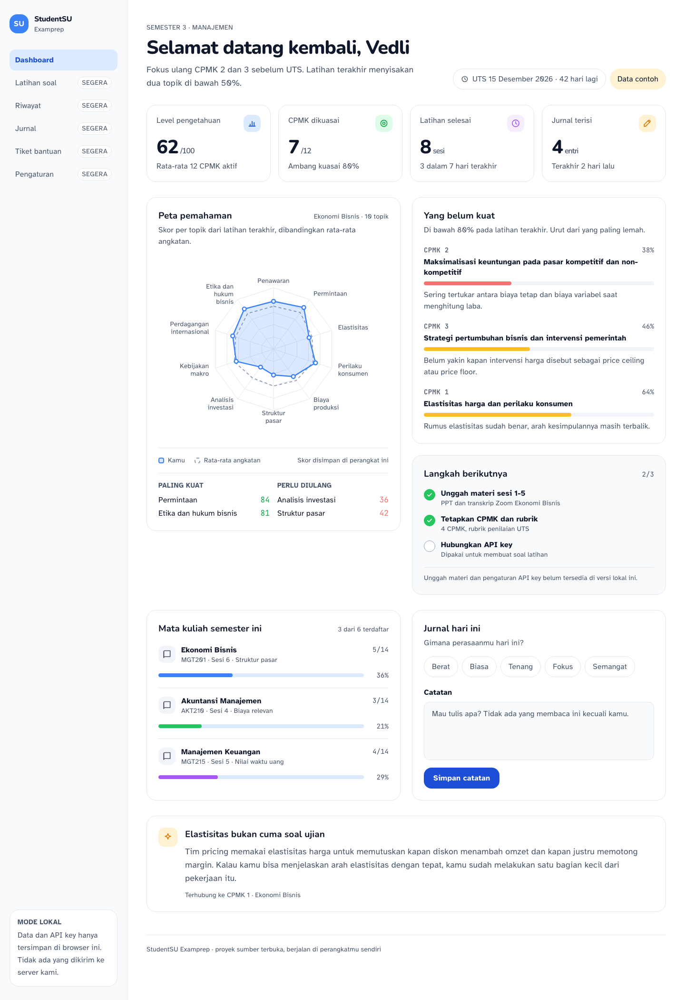

# StudentSU Examprep

Aplikasi latihan soal untuk mahasiswa Satu University (SU), jurusan Manajemen dan Akuntansi, dalam menyiapkan UTS dan UAS.
Materi kuliah (transkrip Zoom, PPT/PDF, referensi buku) dan CPMK dipakai sebagai dasar pembuatan soal latihan yang
dipersonalisasi. Aplikasi berjalan lokal di perangkatmu, memakai API key milikmu sendiri.

Status: **fase 1 — lokal, satu role (Student), sumber terbuka**. Belum ada server, belum ada akun, belum ada pembayaran.



## Kenapa

Materi kuliah tersebar di banyak tempat: rekaman kelas, slide dosen, buku teks, rubrik penilaian, dan daftar CPMK. Menyusun
soal latihan dari semua itu butuh waktu yang justru tidak dimiliki mahasiswa menjelang ujian. Aplikasi ini merapikan alurnya:
pilih mata kuliah, tentukan cakupan sesi, lalu latihan soal yang mengikuti CPMK dan rubrik yang dipakai dosen.

## Yang sudah ada

| Bagian | Status |
| --- | --- |
| Dashboard belajar (level, peta pemahaman CPMK, jurnal) | Ada, data contoh lokal |
| Riwayat latihan, generate soal, unggah materi, tiket, pengaturan API key | Belum |

Rencana lengkap per fitur (F1-F11) ada di [PRD.md](PRD.md). Halaman yang belum dibangun ditandai "Segera" di navigasi dan tidak dipalsukan.

## Menjalankan di lokal

Butuh Node.js 20 atau lebih baru.

```bash
npm install
npm run dev
```

Buka http://localhost:3000. Kalau port itu terpakai:

```bash
npm run dev -- --port 3100
```

Tidak ada variabel lingkungan yang diperlukan. Tidak ada data yang dikirim ke mana pun saat ini.

## Perintah

```bash
npm run dev        # server pengembangan
npm run build      # build produksi
npm run lint       # eslint
npm run typecheck  # tsc --noEmit
```

## Struktur

```
app/               # route App Router (layout, dashboard)
components/        # UI: app-shell, stat-card, skill-radar, gap-list, ...
lib/               # types, data contoh, akses localStorage
skills/            # aturan copywriting dan anti-slop
PRD.md             # requirement produk, alur, model data, kontrak AI
AGENTS.md          # aturan wajib untuk agen AI yang menulis kode di repo ini
skylearn-DESIGN.md # benchmark desain (jangan diubah)
```

## Privasi

- API key (Gemini/OpenAI) hanya disimpan di `localStorage` browser dan hanya dikirim ke host provider yang dipilih.
- Tidak ada telemetry, analytics, atau panggilan jaringan pihak ketiga.
- Materi yang diunggah dibaca di browser dan tidak disimpan di server, karena tahap ini memang tidak punya server.

## Untuk kontributor

Baca [AGENTS.md](AGENTS.md) sebelum menulis kode. Aturannya mengikat, termasuk untuk agen AI: pakai token desain dari
`skylearn-DESIGN.md`, tanpa pustaka chart atau UI kit, tanpa dependency baru tanpa alasan, teks minimal 16px untuk isi,
dan seluruh copy mengikuti [skills/human-copywriter.md](skills/human-copywriter.md).

Commit memakai Conventional Commits. Satu perubahan logis per commit.

## Roadmap

1. **Fase 1 (sekarang).** F1-F11 berjalan lokal, tanpa backend, tanpa biaya.
2. **Fase 2.** SaaS berbasis kredit dan peran Super Admin: Supabase Auth, Postgres dengan RLS, panggilan model pindah ke server,
   katalog mata kuliah dan materi default. Belum dibangun; hanya disiapkan di PRD.
3. **Fase 3.** Integrasi kampus (LMS/SSO SU) dan analitik pembelajaran.

## Lisensi

MIT. Lihat [LICENSE](LICENSE).